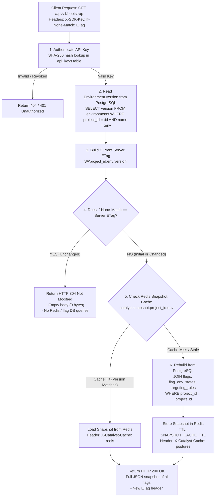

# Catalyst

[](https://github.com/VijeshVS/catalyst/actions/workflows/render-deploy-status.yml)

A feature flag control plane. Ship features with confidence: kill switches, percentage
rollouts, and rule-based targeting, served from a version-validated snapshot so a flag check
is a single conditional request and a local decision.

- **Website** — https://catalyst-service.vercel.app
- **Visual docs** — https://vijeshvs.github.io/catalyst/

---

## Architecture & Evaluation Flow

Catalyst separates the **control plane** (dashboard configuration, credentials, and audit logs) from the **data plane** (sub-millisecond local in-memory evaluation via the SDK).

### 1. Client-Side Evaluation & Background Auto-Refresh

In high-throughput applications, the client runs with `refresh_on_evaluate=False` and a background daemon thread (`client.start_auto_refresh()`). Flag checks execute entirely in local memory with zero network latency.

```mermaid
sequenceDiagram
    autonumber
    participant App as Application Code
    participant SDK as CatalystClient (In-Memory RAM)
    participant Daemon as Daemon Thread (catalyst-auto-refresh)
    participant API as Catalyst API (/bootstrap)

    rect rgb(25, 30, 45)
    Note over App,API: Phase 1: Client Initialization (Zero-I/O & Initial Snapshot)
    App->>SDK: CatalystClient(sdk_key, project_id, env, refresh_on_evaluate=False)
    SDK->>API: Initial GET /api/v1/bootstrap
    API-->>SDK: 200 OK + Initial Flags Snapshot + ETag W/"proj:env:1"
    SDK->>SDK: Store snapshot in local memory (self._snapshot)
    end

    rect rgb(25, 40, 30)
    Note over App,Daemon: Phase 2: Start Background Auto-Refresh Daemon
    App->>SDK: client.start_auto_refresh(interval=30s)
    SDK->>Daemon: Spawn background daemon thread
    loop Every 30 seconds
        Daemon->>API: GET /api/v1/bootstrap (If-None-Match: ETag)
        alt ETag Unchanged (Nothing modified in environment)
            API-->>Daemon: 304 Not Modified (0 bytes body)
            Daemon->>SDK: Keep serving existing in-memory snapshot
        else ETag Changed (Flags / Rules updated on dashboard)
            API-->>Daemon: 200 OK + New Snapshot of All Flags + New ETag
            Daemon->>SDK: Atomic pointer swap: self._snapshot = new_snapshot
        end
    end
    end

    rect rgb(40, 35, 25)
    Note over App,SDK: Phase 3: Client-Side Flag Evaluation (< 0.05ms)
    App->>SDK: client.is_enabled("checkout-v2", user_id="u_123", attributes={"plan": "pro"})
    Note over SDK: Evaluates locally in RAM:<br/>1. Check Kill Switch<br/>2. Check Enable All<br/>3. Match Targeting Rules<br/>4. MurmurHash3 sticky bucket < percentage
    SDK-->>App: Return True / False (Zero network calls, ~3 microseconds)
    end
```



---

### 2. Backend Snapshot Resolution (ETag Mismatch & Cache Rebuild)

When the client requests `/api/v1/bootstrap` (either on startup or when the ETag changes), the backend coordinates between PostgreSQL and Redis to serve the snapshot efficiently:



---

## Usage Example

```python
from catalyst_sdk import CatalystClient

# 1. Initialize with in-memory local evaluation mode
client = CatalystClient(
    sdk_key="cp_prod_a1b2c3d4e5f6g7h8i9j0k1",
    project_id="7c9e6679-7425-40de-944b-e07fc1f90ae7",
    env="prod",
    refresh_on_evaluate=False,  # Evaluates from memory only
)

# 2. Start background auto-refresh daemon once at boot
client.start_auto_refresh(interval=30.0)

# 3. Inside your request handlers (pure in-memory, ~0.003 ms, 0 network I/O):
if client.is_enabled("new-checkout", user_id=current_user.id, attributes={"plan": "pro"}):
    # Render new checkout
    ...
```
