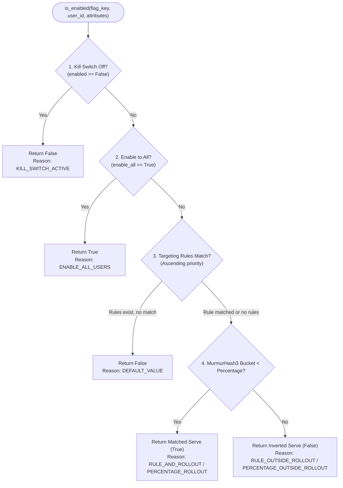

# Product Requirements Document (PRD) — Catalyst Feature Management Platform

**Document Status:** Final Production Specification  
**Product:** Catalyst Feature Flag Control Plane & SDK  

---

## 1. Executive Summary & Value Proposition

**Catalyst** is an enterprise-grade, multi-tenant feature flag and remote configuration management platform. It decouples application deployments from feature releases, empowering product and engineering teams to safely control feature rollouts, conduct progressive canary releases, segment users with granular targeting rules, and instantly mitigate production incidents with zero-downtime emergency kill switches.

The core design philosophy marries **centralized configuration management** with **decentralized, sub-millisecond local evaluation**:
* The **Control Plane** (FastAPI backend + React dashboard) manages organizations, projects, environments, flags, targeting rules, credentials, and audit logs.
* The **Data Plane** (Client SDKs) downloads environment configuration snapshots via HTTP conditional requests (`ETag` / `304 Not Modified`) and evaluates decisions 100% locally in-memory inside application processes in microseconds.

---

## 2. Product Objectives

1. **Decouple Deployment from Release:** Eliminate risky "big-bang" deployments by enabling dark launches, pre-release staging, and instant feature toggling without code changes.
2. **Instant Emergency Blast-Radius Mitigation:** Provide single-click kill switches that immediately shut down broken features in production environments.
3. **Deterministic, Sticky Percentage Rollouts:** Support incremental canary rollouts from 0% to 100% using consistent MurmurHash3 bucketing, ensuring users never flip-flop across sessions or application restarts.
4. **Attribute-Based User Targeting:** Segment beta testers, internal teams, or specific customer tiers using flexible attribute conditions with strict priority ordering.
5. **Sub-Millisecond In-Process Evaluation:** Ensure zero runtime performance penalty by evaluating flags locally in RAM (< 0.05 ms per check) without making network or database calls in the critical request path.
6. **Strict Multi-Tenancy & Complete Auditability:** Enforce strict data and security boundaries across organizations, projects, and environments, with tamper-proof audit trails for every configuration mutation.

---

## 3. User Personas & Workflows

| Persona | Core Responsibility | Key Workflow in Catalyst |
|---|---|---|
| **Release Manager / Site Reliability Engineer (SRE)** | Production stability, deployment velocity | Toggles emergency kill switches during incidents; monitors audit trail; oversees rollout progression. |
| **Product Manager (PM)** | Feature adoption, customer segmentation | Configures 1% → 25% → 50% → 100% canary rollouts; sets up beta testing targeting rules using custom attributes. |
| **Software Engineer (Dev)** | SDK integration, application code | Instantiates `CatalystClient`, calls `client.is_enabled()`, verifies targeting behavior in the Evaluation Playground. |
| **Organization Administrator** | Security, access management | Provisions projects and environments; manages and rotates SHA-256 hashed SDK API keys. |

---

## 4. System Architecture & Tech Stack

Catalyst is engineered for high throughput, predictable latency, and high availability:

* **Backend Control Plane:** FastAPI, Python 3.12, async SQLAlchemy 2.0, `asyncpg`.
* **Primary Database (System of Record):** PostgreSQL 16 (strict relational constraints, cascading lifecycle, indexed UUID keys).
* **Caching Layer:** Redis 7 (stores pre-compiled environment snapshots under `catalyst:snapshot:<project_id>:<env>`; provides non-blocking cache degradation where Redis failure seamlessly falls back to PostgreSQL).
* **Operator Dashboard:** React 19, Vite, TypeScript, React Router v6, Retro Black & Gold design system (`Playfair Display`, `IBM Plex Mono`).
* **Client SDK:** Python SDK (`sdk-catalyst` / `catalyst_sdk`), zero native C dependencies (vendors pure Python MurmurHash3 x86_32), HTTPX-backed transport, fail-closed in-memory evaluation.

---

## 5. Functional Requirements

### FR-1: Multi-Tenant Hierarchy & Environment Isolation
* **Tenancy Structure:** `User -> Organization -> Project -> Environment -> Flag`.
* **Organizations:** Users own organizations. Organization names are globally unique.
* **Environments:** Each project automatically provisions three standard environments: `dev`, `staging`, and `prod`. Custom lowercase environments (e.g., `qa`, `perf-test`) can be dynamically provisioned.
* **State Isolation:** Environments are strictly isolated. A flag key is defined at the project level, but holds independent state (`FlagEnvState`), rollout percentage, and targeting rules in each environment. Updating a flag in `staging` never affects `prod`.

### FR-2: Dual-Switch Flag Controls & Progressive Rollouts
* **Emergency Kill Switch (`enabled`):** When set to `false`, the flag immediately evaluates to `false` for 100% of users, bypassing all rules and percentages.
* **Enable-to-All Switch (`enable_all`):** When set to `true`, the flag immediately evaluates to `true` for 100% of users, bypassing all targeting.
* **Rollout Slider (`percentage`):** Integer from `0` to `100`. Controls the exact percentage of eligible users who receive the feature.
  * Newly created flags are pinned to `0%` rollout by default to prevent accidental dark launch exposure.
  * Rollout slider updates are debounced and optimistic on the frontend.

### FR-3: Deterministic Sticky Bucketing Engine
* **Algorithm:** Pure MurmurHash3 32-bit x86 unsigned integer hashing:
  $$\text{bucket} = (\text{MurmurHash3}(\text{flag\_key} + \text{":"} + \text{user\_id}) \ \& \ \text{0xFFFFFFFF}) \pmod{100}$$
* **Stickiness:** Identical inputs yield identical bucket numbers (`0..99`) across server and client SDKs.
* **Monotonicity Guarantee:** Because a user's bucket is immutable for a given flag key, raising the percentage slider from 20% to 40% is mathematically guaranteed to keep the existing 20% and add new users without churn.

### FR-4: Multi-Attribute Targeting Rules
* Flags support ordered targeting rules evaluated in ascending priority (`priority: 0` is evaluated first).
* Each rule defines 1 to 25 conditions evaluated with **AND** logic (all conditions must match).
* **Supported Operators:**
  * Strict Equality: `equals`, `not_equals`
  * Set Membership: `in`, `not_in` (accepts array or comma-delimited strings)
  * Substring Matching: `contains`, `starts_with`, `ends_with` (case-insensitive)
  * Numerical Comparisons: `greater_than` (`gt`), `greater_than_or_equal` (`gte`), `less_than` (`lt`), `less_than_or_equal` (`lte`)
  * Presence Checks: `exists`, `not_exists` (evaluates context key existence; value ignored)
* **First Match Wins:** The first rule matching the user context claims the user.
* **Exclusion Contract:** If rules are configured for a flag and none match the user, the user is excluded and served `false` (`DEFAULT_VALUE`).

### FR-5: Versioned Bootstrap Snapshot API
* **Endpoint:** `GET /api/v1/bootstrap?project_id=&env=`
* **Authentication:** Dual-mode authentication via operator Bearer JWT or SDK header `X-SDK-Key`.
* **ETag Cache Coherence:** Every mutation increments `Environment.version`. The API derives an HTTP ETag:
  $$\text{ETag} = \text{W/}"\text{project\_id}:\text{env}:\text{Environment.version}"$$
* **Conditional Requests:** Clients send `If-None-Match: <etag>`. If unchanged, the server returns **`304 Not Modified`** with an empty body, avoiding Redis reads, database queries, and JSON serialization.

### FR-6: In-Memory Client SDK (`catalyst_sdk`)
* **Evaluation Speed:** Sub-millisecond (< 0.05 ms per evaluation) in-memory execution.
* **Zero Disk Cache:** Operates purely in application RAM, eliminating file permission issues and stale disk artifacts.
* **Dual Execution Modes:**
  1. *Per-check conditional validation (`refresh_on_evaluate=True`):* Best for short-lived scripts and serverless functions.
  2. *In-memory with background polling (`refresh_on_evaluate=False` + `start_auto_refresh(interval)`):* Dedicated daemon thread polls `/bootstrap` periodically, keeping flag evaluations non-blocking and zero-latency on request threads.
* **Fail-Closed Resilience:** If the control plane becomes unreachable, the SDK serves `false` and activates a failure backoff window (default 5.0 seconds) to prevent cascading connection exhaustion.
* **Zero-Allocation User Scoping:** `client.for_user(user_id, attributes)` binds user context efficiently across request lifecycles.

### FR-7: Operator Dashboard & Evaluation Playground
* **Flag Management:** Live cards featuring status badges, rollout sliders, inline kill switches, and rule builders.
* **Rule Builder:** Interactive condition editor with live client-side match preview.
* **Evaluation Playground:** Interactive debugger allowing operators to input test `user_id` and attributes to simulate evaluation decisions and inspect reason codes.
* **API Keys UI:** Issue, display (revealed once upon creation), and delete project-scoped SDK credentials.

### FR-8: Security & Audit Logging
* **Credential Storage:** API keys formatted as `cp_<env>_<random32>` are stored exclusively as SHA-256 hashes.
* **User Authentication:** Passwords hashed using bcrypt; session tokens issued as signed JWTs (15-minute access token, 7-day refresh token).
* **Immutable Audit Trail:** Append-only logging capturing `actor`, `action`, `user_id`, `user_email`, `timestamp`, and full `before` / `after` JSON diffs on every state mutation.

---

## 6. Evaluation Precedence & Reason Codes

Both the backend and SDK evaluators implement an identical 4-stage precedence model:

---

## 7. Non-Functional Requirements (NFRs)

* **Performance:**
  * SDK in-memory evaluation: < 0.05 ms (p99).
  * API `/bootstrap` 304 Not Modified response: < 15 ms (p95).
  * API `/bootstrap` 200 OK cached snapshot response: < 35 ms (p95).
* **Reliability:**
  * System operational during complete Redis outage (automatic fallback to PostgreSQL).
  * Client applications continue operating normally during Catalyst API outages (fail-closed, cached snapshot retention).
* **Scalability:**
  * Single control plane instance serves up to 5,000 requests/sec on `/bootstrap` via 304 short-circuiting.
* **Data Integrity:**
  * Foreign key cascades preserve referential integrity across projects, environments, flags, states, and rules.
  * Unique constraint on `(project_id, key)` prevents duplicate flag collisions.
