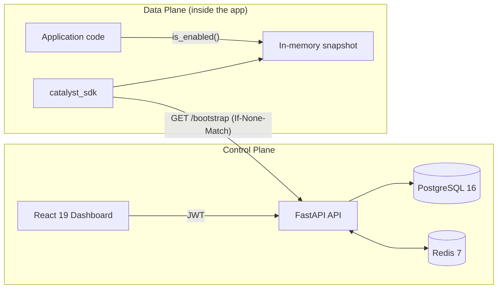
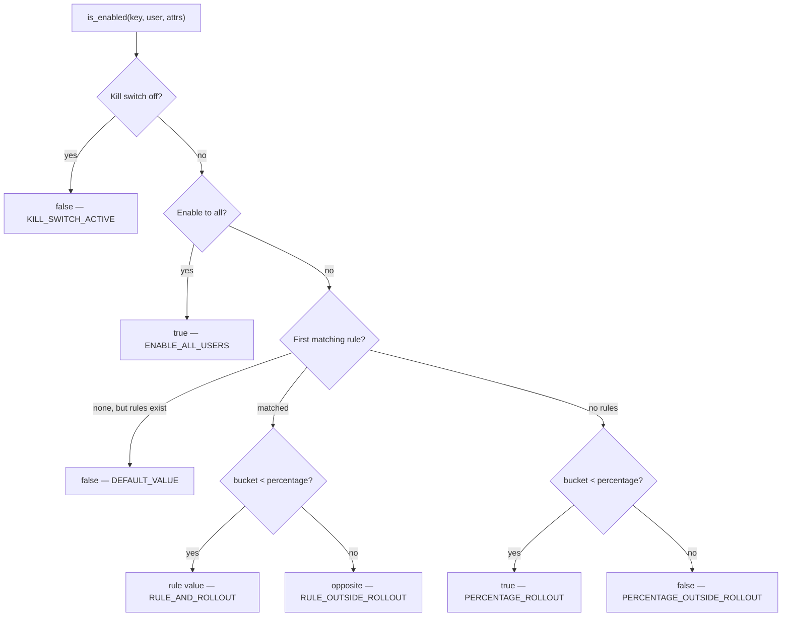

# Catalyst — Presentation Deck Content

**Feature Flag Control Plane & Python SDK**
A short, slide-ready outline: problem → objectives → methodology → results.

Suggested runtime: 12–15 minutes (≈12 slides, ~1 min each).

---

## Slide 1 — Title

**Catalyst**
Ship features without shipping risk.

A feature flag control plane with a sub-millisecond, in-process Python SDK.

- Live dashboard: https://catalyst-service.vercel.app
- Visual docs: https://vijeshvs.github.io/catalyst/
- Repo: `github.com/VijeshVS/catalyst`

**Speaker note:** One sentence — "Catalyst decouples deploying code from releasing features, and makes the runtime cost of a flag check effectively zero."

---

## Slide 2 — Problem Statement

**Deploying code and releasing a feature are the same event. That is the problem.**

Every release is a binary, all-or-nothing event:

- **Big-bang exposure** — a bug reaches 100% of users the moment the deploy finishes.
- **Rollback means redeploy** — the only undo is another build, another pipeline, another outage window.
- **No gradual confidence** — there is no safe way to go 1% → 25% → 100%, or to target only beta users.
- **No emergency brake** — when an incident starts, on-call engineers cannot turn a single feature off without shipping code.
- **Naive flag services add latency** — a network or database call on every flag check puts the control plane in the hot path of every request.
- **Multi-team leakage** — flags for one product/environment bleed into another without strict tenancy.
- **No accountability** — nobody can answer "who turned this on, when, and what changed?"

**Speaker note:** Frame it as a release-engineering problem, not a "flags are nice" problem. The cost of the status quo is incident blast radius and slow rollback.

---

## Slide 3 — Objectives (what the system must do)

Eight concrete objectives, each traceable to a feature:

1. **Decouple deploy from release** — dark-launch code safely at 0% rollout.
2. **Instant kill switch** — one toggle returns `false` to everyone, no deploy.
3. **Deterministic sticky rollouts** — 0–100% bucketing that never reshuffles users.
4. **Attribute-based targeting** — first-match-wins rules over 13 operators.
5. **Sub-millisecond evaluation** — decisions made locally in application memory.
6. **Strict multi-tenancy** — Org → Project → Environment isolation.
7. **Complete auditability** — every mutation recorded with before/after state.
8. **Self-service operator experience** — dashboard, playground, API keys, docs.

**Speaker note:** These map 1:1 to the functional requirements FR-1…FR-8 in `docs/PRD.md`.

---

## Slide 4 — Feature Walkthrough (the objectives, made concrete)

**Flag controls**
- Emergency kill switch (`enabled`) — overrides everything.
- Enable-to-all (`enable_all`) — ship to everyone, no targeting.
- Rollout slider (`percentage`, 0–100) — debounced, optimistic UI, one PATCH per drag.
- New flags are pinned to **0%** so nothing goes live by accident.

**Targeting**
- Ordered rules, `priority 0` first; **first match wins**.
- 1–25 conditions per rule, ANDed.
- Operators: `equals`, `not_equals`, `in`, `not_in`, `contains`, `starts_with`, `ends_with`, `greater_than`, `greater_than_or_equal`, `less_than`, `less_than_or_equal`, `exists`, `not_exists`.
- Aliases (`eq`, `neq`, `gt`, `gte`, `lt`, `lte`, `notExists`) normalized on write.

**Environments & credentials**
- Auto-provisioned `dev` / `staging` / `prod`; custom lowercase envs (`qa`, `perf-test`).
- Project-scoped SDK keys: `cp_<env>_<random32>`, stored **only as SHA-256 hashes**, shown once.

**Observability & safety**
- Immutable audit log with actor, action, timestamp, before/after diff.
- Evaluation Playground that returns the **reason code**, not just true/false.
- Public SDK documentation at `/docs`.

**Speaker note:** Pick two to demo live: kill switch propagation and the playground reason codes.

---

## Slide 5 — Methodology: Architecture (control plane vs data plane)

**The core design decision: split configuration from evaluation.**



- **Control plane** — dashboard + REST API own configuration, credentials, and audit.
- **Data plane** — the SDK downloads a snapshot and decides **locally**.
- The network is never in the request path of a flag check.

**Tech stack:** FastAPI · Python 3.12 · SQLAlchemy 2.0 async · asyncpg · PostgreSQL 16 · Redis 7 · React 19 · Vite · TypeScript · httpx · MurmurHash3.

---

## Slide 6 — Methodology: The Evaluation Algorithm

**A fixed, documented 4-stage precedence model — identical on server and SDK.**



**Sticky bucketing (the monotonicity guarantee):**

```
bucket = (MurmurHash3_x86_32("flag_key:user_id") & 0xFFFFFFFF) % 100
```

- Same flag + same user ⇒ same bucket forever.
- Raising 20% → 40% can only **add** users; nobody is removed. No flip-flopping across sessions or restarts.
- Pure-Python MurmurHash3 is vendored into the SDK, so there is no native build step and the client matches the server bit-for-bit.

**Speaker note:** The "opposite of the rule value outside the bucket" detail is what makes rules and percentage partition the matched group exactly.

---

## Slide 7 — Methodology: Snapshot Delivery & Cache Coherence

**How a dashboard toggle becomes a local decision without hammering the database.**

1. Every mutation bumps `Environment.version` and drops the Redis cache key.
2. `GET /api/v1/bootstrap` derives an ETag: `W/"project:env:version"`.
3. Client sends `If-None-Match`.
   - **Unchanged** → `304 Not Modified`, empty body, no Redis read, no DB query.
   - **Changed** → `200` with the snapshot, served from Redis (`X-Catalyst-Cache: redis`) or rebuilt from PostgreSQL on a miss.
4. SDK performs an **atomic pointer swap** of an immutable snapshot, so request threads always see a consistent view.
5. Two client modes:
   - `refresh_on_evaluate=True` — conditional check per evaluation (scripts, serverless).
   - `refresh_on_evaluate=False` + `start_auto_refresh(30s)` — zero-network checks in the hot path.
6. **Fails closed** — if the control plane is unreachable, the SDK serves `false` and backs off (5s default) instead of cascading timeouts.
7. **Redis is optional** — a cache outage degrades to PostgreSQL, never to an error.

---

## Slide 8 — Methodology: Security, Tenancy & Quality Engineering

**Security**
- Passwords: bcrypt. Sessions: JWT access (15 min) + refresh (7 days).
- API keys hashed with SHA-256; authentication compares hashes only — the visible prefix is never trusted.
- Every lookup is owner-scoped and returns `404` for inaccessible resources, preventing ID enumeration.
- Project/environment scoping enforced on every flag, evaluate, bootstrap, and audit query.

**Testing methodology**
- **Self-contained suites** — SQLite + fake Redis, no external services required.
- **Differential (parity) fuzzing** — the same randomized inputs are run through the server evaluator and the SDK evaluator; values, reasons, and rule IDs must match exactly. This is the guardrail against semantic drift.
- **Behavioral coverage** — sticky hashing, monotonic rollout, kill switch, rule precedence, cross-tenant isolation, ETag 304→200 invalidation, cache degradation, auth flows, rate limiting, key lifecycle.

**Delivery methodology**
- Trunk-based feature branches → PR → CI gates → auto-deploy.
- Conventional Commits, PR hygiene checks, required test/lint/build jobs.
- Deployed on Render (API + Redis) and Vercel (dashboard), with Neon PostgreSQL.

---

## Slide 9 — Results / Outcomes (measured)

**Verification — 318 automated tests, all passing**

| Suite | Tests | Scope |
|---|---:|---|
| Backend (pytest) | **113** | API, auth, tenancy, evaluation, caching, audit |
| Python SDK (pytest) | **106** | Client, transport, evaluator, user scoping |
| Frontend (Vitest) | **99** | Routing, API client, rule builder, slider, docs search |
| **Total** | **318** | plus server↔SDK parity fuzzing |

**Performance — measured on the SDK evaluator**

- **7.58 µs per evaluation** (~0.008 ms, ≈132,000 evaluations/sec on one core).
- Includes rule matching, attribute checks, and MurmurHash3 bucketing.
- Zero network I/O, zero disk I/O, zero database calls in the hot path.

**System scale**

- 16 REST endpoints · 9 data models · 15 dashboard pages · 16 reusable components.
- ~13,300 lines of application code (3.4k backend, 8.5k frontend, 1.4k SDK).
- 82 commits, deployed and publicly reachable.

**Behavioral guarantees achieved**

- Kill switch overrides every rule and percentage — no deploy required.
- Rollout is monotonic: 5% → 25% → 100% never removes an already-enrolled user.
- Unchanged environments cost a `304` with an empty body.
- Server and SDK return identical decisions, reasons, and rule IDs under fuzzing.
- A Redis outage degrades to PostgreSQL; an API outage fails closed.

---

## Slide 10 — Demo Script (optional, 2–3 minutes)

1. **Create a flag** at 0% — show it is safe by default.
2. **Open the Playground** — evaluate one user, show `PERCENTAGE_OUTSIDE_ROLLOUT`.
3. **Move the slider to 50%** — re-evaluate the same user, show the decision change with `PERCENTAGE_ROLLOUT`.
4. **Add a rule** (`plan in [pro, enterprise]`) — show the live match preview in the rule builder.
5. **Hit the kill switch** — show `KILL_SWITCH_ACTIVE` and that it overrides the rule.
6. **Check the audit page** — show actor, action, and before/after diff.
7. **Show `curl` of `/bootstrap`** twice — second call returns `304` with the same ETag.

---

## Slide 11 — Limitations & Honest Trade-offs

- Single-owner tenancy model; no team roles or RBAC yet.
- Refresh tokens are stateless and reusable until expiry.
- Frontend refresh token is stored in `localStorage` (documented MVP trade-off; not `httpOnly`).
- Python SDK only; the hashing algorithm is portable, but JS/Go SDKs are future work.
- No offline disk cache by design — the system chooses fail-closed over serving stale decisions.
- Free-tier hosting: cold starts (~1 min) and no backups.

**Speaker note:** Naming the limits is what makes the results credible.

---

## Slide 12 — Conclusion & Future Work

**What was delivered**

> A working, tested, deployed feature-flag platform that separates deployment from release, evaluates locally in microseconds, and gives operators a kill switch, sticky rollouts, targeting rules, tenant isolation, and a full audit trail.

**Next steps**

- RBAC and multi-user organizations.
- SDKs for JavaScript/TypeScript and Go.
- Scheduled/automated progressive rollouts with metric guardrails.
- Webhooks and experiment analytics.
- Stronger token storage (httpOnly refresh cookies).

**Close:** "Catalyst makes releasing a feature a decision you can reverse in one click — not a deployment you have to survive."

---

## Appendix — Numbers You Can Quote

| Claim | Source |
|---|---|
| 113 backend tests | `cd backend && uv run pytest` |
| 106 SDK tests | `cd packages/catalyst-python-sdk && uv run --with pytest --with mmh3 pytest` |
| 99 frontend tests | `cd frontend && npm run test` |
| 7.58 µs/eval | 200,000 evaluator calls, `time.perf_counter` |
| 16 endpoints | route decorators in `backend/app/api/v1` |
| 9 models | `backend/app/models/models.py` |
| ~13.3k LOC | `backend/app` 3,425 · `frontend/src` 8,461 · SDK `src` 1,396 |
| 13 operators | `RULE_OPERATORS` in `app/services/evaluator.py` |
| 82 commits | `git log --oneline \| wc -l` |

**Design docs:** `docs/PRD.md` (requirements) · `docs/TECH_SPEC.md` (architecture) · `docs/USE_CASES.md` (workflows) · `README.md` (diagrams).
