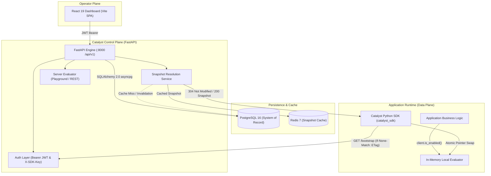
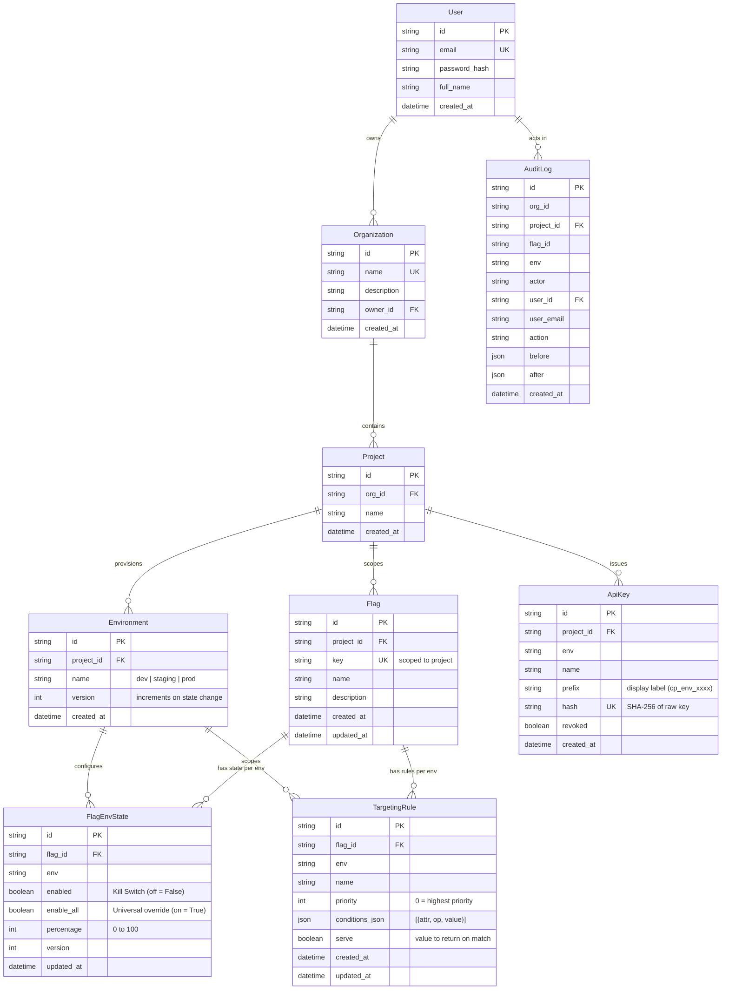

# Technical Specification — Catalyst Feature Management Platform

**Document Status:** Production Technical Specification  
**System:** Catalyst Control Plane, Evaluation Service & Client SDK  

---

## 1. System Architecture

Catalyst provides a decoupled control and data plane architecture:



---

## 2. Monorepo Structure

```text
catalyst/
├── backend/
│   ├── app/
│   │   ├── api/v1/          # Endpoints: auth, organizations, projects, flags, evaluate, bootstrap, audit
│   │   ├── core/            # Config, DB engine, Redis cache client, security & password hashing
│   │   ├── models/          # SQLAlchemy 2.0 async models
│   │   ├── schemas/         # Pydantic v2 validation models
│   │   ├── services/        # snapshots, evaluator, environments, rules, api_keys
│   │   └── main.py          # FastAPI lifespan initialization and routing
│   ├── tests/               # pytest suite backed by in-memory SQLite (aiosqlite)
│   └── pyproject.toml
├── frontend/
│   ├── src/
│   │   ├── auth/            # AuthContext, ProtectedRoute, PublicOnlyRoute
│   │   ├── components/      # FlagCard, RolloutSlider, RuleBuilder, EvalPlayground, Sidebar
│   │   ├── lib/             # targeting helpers, attribute catalogue, docs search, clipboard
│   │   ├── pages/           # Landing, OrgDashboard, ProjectDetail, ApiKeys, Audit, Docs
│   │   ├── workspace/       # WorkspaceContext, useProject hook
│   │   ├── App.tsx          # Route registry
│   │   └── api.ts           # Typed client with automatic JWT refresh
│   ├── package.json
│   └── vite.config.ts
├── packages/catalyst-python-sdk/
│   ├── src/catalyst_sdk/    # client, evaluator, hashing (pure Murmur3), snapshot, transport
│   ├── tests/               # pytest suite covering hashing parity, caching, and auto-refresh
│   └── pyproject.toml
├── docker-compose.yml       # Local PostgreSQL 16 & Redis 7 services
└── Makefile
```

---

## 3. Relational Data Model (SQLAlchemy 2.0)

All primary keys are UUIDv4 strings. Cascading deletes enforce clean relational lifecycles.



### Relational Constraints & Indexing Rules
* **Project Flag Uniqueness:** `UniqueConstraint("project_id", "key", name="uq_project_flag_key")`.
* **State Uniqueness:** `UniqueConstraint("flag_id", "env", name="uq_flag_env_state")`.
* **Environment Uniqueness:** `UniqueConstraint("project_id", "name", name="uq_project_env_name")`.
* **Dense Rule Ordering:** Rules are indexed on `("flag_id", "env", "priority")`. Mutating rules renormalizes priorities sequentially (`0..n-1`).
* **Version Invalidation:** Modifying any `FlagEnvState` or `TargetingRule` executes `bump_environment_versions()`, which increments `Environment.version` and purges the Redis snapshot key.

---

## 4. REST API Contract (`/api/v1`)

### Authentication & Users
* `POST /api/v1/auth/register` — Register owner account.
* `POST /api/v1/auth/login` — Authenticate with email/password; returns 15-minute access token and 7-day refresh token.
* `POST /api/v1/auth/refresh` — Stateless access token renewal via refresh token.
* `GET /api/v1/auth/me` — Current authenticated user profile.

### Multi-Tenancy
* `GET|POST /api/v1/organizations` — List owned organizations / create new organization.
* `GET /api/v1/organizations/{org_id}` — Organization details and projects.
* `POST /api/v1/organizations/{org_id}/projects` — Create project; auto-provisions `dev`, `staging`, and `prod` environments.
* `GET|POST /api/v1/projects/{project_id}/environments` — List environments / provision custom lowercase environment (`qa`, `perf`).

### Flag & Rule Management
* `GET /api/v1/flags?project_id=` — List all flags for a project, including per-environment status summaries.
* `POST /api/v1/flags?project_id=` — Create flag; seeds initial `FlagEnvState` rows for every environment (`percentage: 0`, `enabled: true`).
* `PATCH /api/v1/flags/{key}?project_id=` — Update name or description.
* `PATCH /api/v1/flags/{key}/environments/{env}?project_id=` — Mutate kill switch (`enabled`), enable-all (`enable_all`), or rollout `percentage` (`0..100`).
* `GET|POST /api/v1/flags/{key}/environments/{env}/rules?project_id=` — List or append targeting rules.
* `PUT /api/v1/flags/{key}/environments/{env}/rules/reorder?project_id=` — Reorder rules; renormalizes priority to `0..n-1`.
* `PUT|DELETE /api/v1/flags/{key}/environments/{env}/rules/{rule_id}?project_id=` — Update or delete a rule.

### Evaluation & Snapshots
* `GET /api/v1/bootstrap?project_id=&env=` — Returns full environment snapshot. Accepts Bearer token or `X-SDK-Key`. Supports HTTP `If-None-Match` for `304 Not Modified`.
* `POST /api/v1/evaluate?project_id=` — Evaluates a single flag remotely (used by Evaluation Playground).
* `POST /api/v1/batch-evaluate?project_id=` — Evaluates multiple flags for a given context.
* `GET /api/v1/audit?project_id=` — Paginated audit log timeline for a project.

### SDK Credentials
* `POST /api/v1/projects/{project_id}/keys` — Generates a new API key (`cp_<env>_<random32>`). Hashes with SHA-256 before storage; raw key returned once upon creation.
* `GET /api/v1/projects/{project_id}/keys` — Lists active keys (displays prefix label only).
* `DELETE /api/v1/projects/{project_id}/keys/{key_id}` — Deletes key; writes audit log entry.

---

## 5. Evaluation Engine & Precedence Order

Evaluation logic is identical between the FastAPI service ([`evaluator.py`](file:///Users/vijeshshetty/Documents/projects/catalyst/backend/app/services/evaluator.py)) and the Python SDK ([`evaluator.py`](file:///Users/vijeshshetty/Documents/projects/catalyst/packages/catalyst-python-sdk/src/catalyst%5Fsdk/evaluator.py)).

### Precedence Steps

1. **Emergency Kill Switch:**
   ```python
   if not enabled:
       return False, "KILL_SWITCH_ACTIVE", None
   ```
2. **Enable to All Users:**
   ```python
   if enable_all:
       return True, "ENABLE_ALL_USERS", None
   ```
3. **Targeting Rules (Ordered Ascending by Priority):**
   ```python
   matched = None
   for rule in sorted(rules, key=lambda item: item["priority"]):
       if match_rule(rule["conditions"], attributes):
           matched = rule
           break

   if rules and matched is None:
       return False, "DEFAULT_VALUE", None
   ```
4. **Deterministic Sticky Rollout (MurmurHash3):**
   ```python
   raw_hash = mmh3.hash(f"{flag_key}:{user_id}")
   bucket = (raw_hash & 0xFFFFFFFF) % 100
   serve = True if matched is None else matched["serve"]

   if bucket < percentage:
       reason = "RULE_AND_ROLLOUT" if matched else "PERCENTAGE_ROLLOUT"
       return serve, reason, matched_id
   else:
       reason = "RULE_OUTSIDE_ROLLOUT" if matched else "PERCENTAGE_OUTSIDE_ROLLOUT"
       return not serve, reason, matched_id
   ```

### Condition Matching Operators

| Operator | Canonical Name | Match Logic | Value Handling |
|---|---|---|---|
| `equals`, `eq` | `equals` | Strict equality (`actual == target`) | Type-safe (booleans, strings, ints) |
| `not_equals`, `neq` | `not_equals` | Strict inequality (`actual != target`) | Inverted equality |
| `in` | `in` | Membership check | Accepts list or comma-separated string |
| `not_in` | `not_in` | Negative membership check | Inverted `in` |
| `contains` | `contains` | Substring inclusion | Case-insensitive |
| `starts_with` | `starts_with` | Substring prefix | Case-insensitive |
| `ends_with` | `ends_with` | Substring suffix | Case-insensitive |
| `greater_than`, `gt` | `greater_than` | Float comparison (`float(actual) > float(target)`) | Unparseable values safely evaluate to `False` |
| `greater_than_or_equal`, `gte` | `greater_than_or_equal` | Float comparison (`float(actual) >= float(target)`) | Unparseable values safely evaluate to `False` |
| `less_than`, `lt` | `less_than` | Float comparison (`float(actual) < float(target)`) | Unparseable values safely evaluate to `False` |
| `less_than_or_equal`, `lte` | `less_than_or_equal` | Float comparison (`float(actual) <= float(target)`) | Unparseable values safely evaluate to `False` |
| `exists` | `exists` | Key presence (`attr in attributes`) | Target value ignored |
| `not_exists` | `not_exists` | Key absence (`attr not in attributes`) | Target value ignored |

---

## 6. Snapshot Cache & ETag Mechanics

### Storage & Invalidation
* Key format: `catalyst:snapshot:<project_id>:<env>`
* Cached value: JSON structure containing `version` and the serialized `flags` mapping.
* **Cache Miss / Update:** Rebuilt via an asynchronous PostgreSQL join:
  ```sql
  SELECT * FROM flags
  JOIN flag_env_states ON ...
  JOIN targeting_rules ON ...
  WHERE flags.project_id = :project_id;
  ```
* **Graceful Degradation:** All Redis calls in [`cache.py`](file:///Users/vijeshshetty/Documents/projects/catalyst/backend/app/core/cache.py) swallow Redis connection or timeout errors, treating outages as a cache miss and proceeding to PostgreSQL.

### HTTP ETag Protocol
* The server computes the ETag using the environment version:
  $$\text{ETag} = \text{W/}"\text{project id}:\text{env}:\text{Environment.version}"$$
* If incoming `If-None-Match` equals the computed ETag, the server returns **`304 Not Modified`** without accessing Redis or loading flag data.

---

## 7. Python Client SDK Implementation (`sdk-catalyst`)

### Core Features
* **Zero External Dependencies:** Only runtime requirement is `httpx`.
* **Embedded MurmurHash3:** Vendors standalone 32-bit x86 MurmurHash3 in pure Python ([`hashing.py`](file:///Users/vijeshshetty/Documents/projects/catalyst/packages/catalyst-python-sdk/src/catalyst%5Fsdk/hashing.py)), verified against native `mmh3`.
* **Atomic Snapshot Swaps:** Snapshot updates are applied via a single pointer assignment (`self._snapshot = new_snapshot`), providing lock-free, race-condition-free reads for evaluation workers.
* **Concurrency Collapse (Single-Flight):** Multiple concurrent threads attempting to refresh are collapsed into a single HTTP request using a read lock.
* **Fail-Closed Resilience:** A transport failure triggers a `failure_backoff` window (default 5.0 seconds). Flags evaluate to `False` without blocking application request threads.
* **User-Scoped Client (`for_user`):** Returns a `__slots__` proxy view binding a specific `user_id` and context dictionary without duplicating transport or memory connections.

---

## 8. Testing & Quality Verification

* **Backend Suite (`backend/tests/`):** 113+ tests using `pytest` and `aiosqlite` (in-memory SQLite), requiring zero live database infrastructure.
* **SDK Suite (`packages/catalyst-python-sdk/tests/`):** 106+ unit tests covering hash distribution, ETag 304 handling, single-flight locking, and auto-refresh daemon recovery.
* **Differential Parity Fuzzing (`backend/tests/test_sdk_parity.py`):** Fuzz testing suite comparing FastAPI server evaluation against the Python SDK across 1,000+ random attribute vectors, verifying byte-for-byte reason code and decision parity.
* **Frontend Suite (`frontend/src/test/`):** 99+ Vitest tests covering route navigation, auth token refresh, rollout slider debouncing, and rule builder validation.
